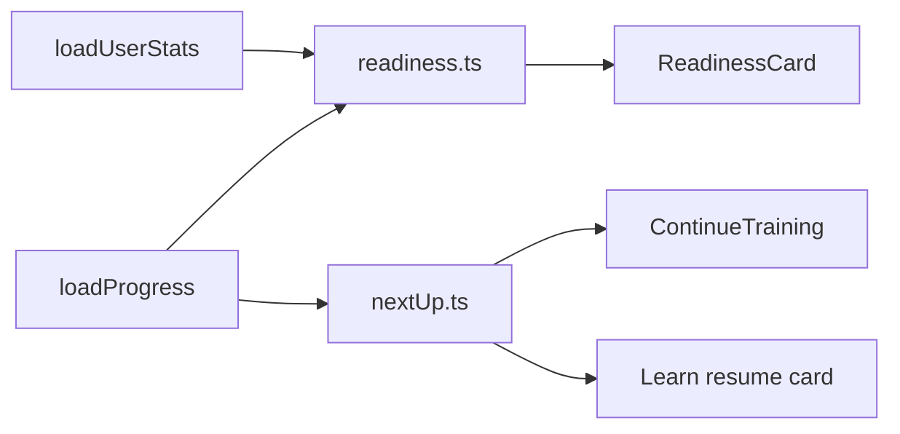

# Dashboard: replace mocks with real features

Replace the hardcoded/mocked pieces on the Audible dashboard with real, on-device features driven by existing SRS progress, stats and playbook storage. Hide the team/collab UI that would need a backend.

App: `football-flashcards` (Expo SDK 57, Expo Router, AsyncStorage).

Main files:

- [app/(tabs)/index.tsx](../app/(tabs)/index.tsx)
- [app/(tabs)/_layout.tsx](../app/(tabs)/_layout.tsx)
- [app/(tabs)/learn.tsx](../app/(tabs)/learn.tsx)
- [src/features/dashboard/Welcome.tsx](../src/features/dashboard/Welcome.tsx)
- [src/features/dashboard/ReadinessCard.tsx](../src/features/dashboard/ReadinessCard.tsx)
- [src/features/dashboard/ContinueTraining.tsx](../src/features/dashboard/ContinueTraining.tsx)
- [src/features/dashboard/QuickTools.tsx](../src/features/dashboard/QuickTools.tsx)
- [src/features/builder/PlayBuilder.tsx](../src/features/builder/PlayBuilder.tsx)
- [src/features/builder/Inspector.tsx](../src/features/builder/Inspector.tsx)
- [src/features/builder/useBuilderState.ts](../src/features/builder/useBuilderState.ts)
- [src/training/storage.ts](../src/training/storage.ts)
- [src/training/types.ts](../src/training/types.ts)

Decisions already made: team/collab UI is hidden (no backend). The profile is a simple on-device profile.

## Todos

- [x] **Phase 1:** Hide Team tab, "View team" link, presence dot, and builder collab footer
- [x] **Phase 2:** Add local UserProfile storage + edit sheet; wire Welcome greeting and top bar avatar/name/role
- [x] **Phase 3:** Create readiness helper and rewire ReadinessCard to real SRS/stats data with a "Review due" link
- [x] **Phase 4:** Add nextUpTopics helper; make ContinueTraining and Learn resume card data-driven with real minute estimates; refresh savedCount on focus
- [x] **Phase 5:** Persist assignments + name on save; fix toolbar title/concept label; make Inspector title and route preview reflect selection
- [x] **Phase 6:** Implement Search modal (plays + topics) and Help sheet; wire top bar buttons (desktop + mobile)
- [x] **Phase 7:** Remove dead db.ts/stale comment, add Jest tests for new helpers, run lint/typecheck/tests

## What is mocked today

- **Welcome** (`Welcome.tsx`): the name "Coach." is hardcoded. The date and time-of-day greeting are already real.
- **ReadinessCard** (`ReadinessCard.tsx`): `score=82`, `complete=24`, `total=29` and "Week 4 prep" are all fake. "View team" links to a placeholder screen.
- **ContinueTraining** (`ContinueTraining.tsx`): the topics are fixed to formations and passing routes. The "7 MIN" / "12 MIN" labels and the "Identify offensive sets" copy are hardcoded. It also calls `generateCards` on every render. The same fake "7 MIN LEFT" appears in `learn.tsx`.
- **QuickTools**: mostly real, but `savedCount` only refreshes on mount in `index.tsx`. Tabs stay mounted, so the count goes stale after you change the playbook.
- **Top bar** (`_layout.tsx`): the Search and Help `IconButton`s have no `onPress`. "Coach Miller / Offense / CM" is hardcoded, and so is the online presence dot.
- **PlayBuilder pane** (`PlayBuilder.tsx`, `Inspector.tsx`):
  - "OFFENSE · CONCEPT 04" is a fixed string.
  - The title is `{formation} Right 62`, which ignores the selected concept.
  - "5 coaches viewing this play" is fake.
  - Save stores only the playcall string, so applied route assignments are lost and the name is just the playcall.
  - The Inspector's route preview is a fixed SVG path, and the title always says "Receiver" regardless of position.

## Phase 1: Hide what needs a backend

- In `_layout.tsx`, remove the Team entry from `TABS` and set `Tabs.Screen name="team"` to `href: null`, the same way `playground` is hidden. Leave `team.tsx` in place for later.
- Remove the "View team" link and the presence dot.
- Remove the collab footer (`AvatarStack` + "5 coaches viewing") from `PlayBuilder`. Keep `KeyHint`.

## Phase 2: Local profile

- Add a `UserProfile { name, role }` type, and `loadProfile` / `saveProfile` in `src/training/storage.ts` under a new `audible/profile` key. Add the same key to the Jest in-memory branch.
- Welcome shows "Good morning, {name}." and falls back to "Coach" when the name is unset.
- The top bar avatar initials, name and role come from the profile.
- Tapping the profile opens a small modal or sheet to edit the profile. Prompt for it on first launch, dismissible.

## Phase 3: Real readiness card

Turn the card into a personal readiness score computed from existing `CardProgress` (new pure helper `src/features/dashboard/readiness.ts`):

- `coverage` = seen cards / total cards across the core topics.
- `retention` = share of seen cards that are not due, using `isDue`.
- `score` = `round(100 * (0.6*coverage + 0.4*retention))`.
- Title becomes "Your readiness". The subtitle is the current week from `UserStats`, e.g. "N of M sessions this week", instead of "Week 4 prep".
- Meta line: "X of Y cards learned · Z due today".
- The link changes from "View team" to "Review due", which opens the topic with the most due cards.

## Phase 4: Real "Up next"

- Add `nextUpTopics(progress, n)` (in `src/features/learn/progress.ts` or a new `nextUp.ts`) with this priority: topics with due cards first, ordered by most overdue; then in-progress topics; then the least-started topic.
- `ContinueTraining` renders the top 2 using `TOPIC_META` for title, description, icon and tone.
- The minutes estimate is `dueCards * ~20s`, rounded, replacing the hardcoded labels.
- Memoize the card generation.
- Reuse the same helper for "MIN LEFT" and the resume topic in `learn.tsx`, which is currently hardcoded to formations.
- QuickTools: refresh `savedCount` with `useFocusEffect`, and scroll to the builder on mobile when "New play" is pressed.

## Phase 5: Make the builder real

- Extend `PlaybookPlay` with `assignments?: Record<string, AssignmentOverride>`. Persist and reload them in `addPlayToBook`, and apply them in `app/play/[id].tsx`.
- Add a name field. Save uses it and falls back to the playcall.
- Fix the toolbar title to use `builder.playcall`, and derive the "OFFENSE · {concept}" label from the selected concept and formation.
- Inspector:
  - Use the selected player's position in the title.
  - Draw the route preview from the selected route and depth.
  - Widen `ROUTE_CHOICES` beyond 4, using `src/data/routes.ts`.

## Phase 6: Search and Help buttons

- Search: a modal that filters saved plays (reuse the logic in `playbook.tsx`) and training topics, and navigates to `/play/[id]` or `/train/[topic]`.
- Help: a sheet with the playcall grammar (from the README), a keyboard shortcut list (Cmd/Ctrl+S) and a short "how training works" blurb. Wire it into the mobile top bar as well.

## Phase 7: Housekeeping

- The `storage.ts` header claims native uses `storage.native.ts`, but that file does not exist and `src/storage/db.ts` (SQLite) is never imported. AsyncStorage is already used on every platform. Remove the dead `db.ts` and fix the comment.
- Add Jest tests in `src/__tests__/` for `readiness.ts`, `nextUp.ts` and the profile storage. `testMatch` only picks up `.ts` files, so these must stay pure logic.
- Per `AGENTS.md`, check the Expo SDK 57 docs before touching any Expo API, and run `npx expo lint`, `npm run typecheck` and `npm test` at the end.

## Assumptions

- The readiness formula (60% coverage / 40% retention) and ~20s per card are defaults.
- The Team tab is hidden, not deleted.
- The search modal and help sheet are lightweight, not a full command palette.
