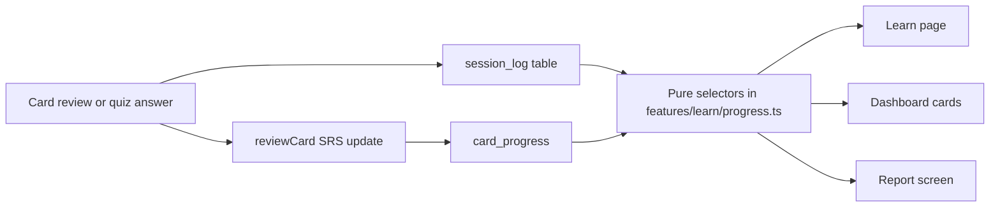

# Learn + Dashboard: replace mocks with real features

Replace the hardcoded numbers, fake visuals, and static content on the Learn page (and the matching dashboard cards) with real data from the existing SRS and storage layer. This needs a small session-history store, a handful of pure selectors, a card-driven quiz engine, and a report screen.

App: `football-flashcards` (Expo 57 / RN, Expo Router, SQLite on native and AsyncStorage on web).

Main files:

- [app/(tabs)/learn.tsx](../app/(tabs)/learn.tsx)
- [app/learn/quiz.tsx](../app/learn/quiz.tsx)
- [app/(tabs)/index.tsx](../app/(tabs)/index.tsx)
- [app/(tabs)/_layout.tsx](../app/(tabs)/_layout.tsx)
- [src/features/learn/progress.ts](../src/features/learn/progress.ts)
- [src/features/dashboard/ContinueTraining.tsx](../src/features/dashboard/ContinueTraining.tsx)
- [src/features/dashboard/ReadinessCard.tsx](../src/features/dashboard/ReadinessCard.tsx)
- [src/features/dashboard/Welcome.tsx](../src/features/dashboard/Welcome.tsx)
- [src/training/types.ts](../src/training/types.ts)
- [src/training/srs.ts](../src/training/srs.ts)
- [src/training/storage.ts](../src/training/storage.ts)
- [src/training/storage.native.ts](../src/training/storage.native.ts)
- [src/training/storageAsync.ts](../src/training/storageAsync.ts)
- [src/storage/db.ts](../src/storage/db.ts)

Decisions already made: team readiness and assignments are out of scope (they need a backend). Lessons are card chunks, not authored content. XP is a simple stored score. Search is a small local filter or it is removed.

## Todos

- [x] **Phase 0:** Add `session_log` + settings (weekly goal, display name) to SQLite/AsyncStorage backends, pure helpers in `storageSeed`, and tests
- [x] **Phase 1:** Add pure selectors in `features/learn/progress.ts`: `weekDays`, `dueCount`, `nextUp`, `estimateMinutes`, `masteryPercent`, `seasonBestStreak`
- [x] **Phase 2:** Wire Learn page: real week strip, editable goal, `nextUp` resume card with FieldCanvas thumbnail, working Browse library, due badges, lesson chunks
- [x] **Phase 3:** Build quiz engine (`training/quiz.ts`) from cards; rewrite quiz screen and Quick read widget to use real scenes, update SRS, persist XP and session log
- [x] **Phase 4:** Create `app/learn/report.tsx` (mastery by topic, trends, weakest cards, due) and link from Mastery card
- [x] **Phase 5:** Make ContinueTraining, Welcome/top-bar profile, and ReadinessCard (local study readiness) data-driven; wire or remove Search/Help buttons
- [x] **Phase 6:** Run jest, typecheck, lint; manual check on web and native for storage parity and empty/mid-week states

## What is mocked today

**Learn page** ([app/(tabs)/learn.tsx](../app/(tabs)/learn.tsx)):

- **Weekly goal strip**
  - The goal is fixed at 4 and not editable.
  - Day cells mark the first N days of the week as complete (`weekSessions > index`) instead of the days you actually studied.
- **Streak card**: "Best this season" is really the all-time `bestStreak`.
- **Resume card**
  - Always points at `formations`.
  - The thumbnail is fake `X / Y / QB` text.
  - "7 MIN LEFT" is hardcoded.
  - The subtitle is a placeholder string.
- **Hero buttons**: "Browse library" only resets the filter.
- **Module cards**
  - `lessons` is static metadata in `TOPIC_META` and isn't backed by any lesson content.
  - Progress is "cards seen at least once", not mastery.
- **Quick read widget**
  - The question, answers, "01 / 05" counter, and text-based field are all hardcoded.
  - The selected answer is not persisted.
- **Mastery card**
  - "Season progress" is the same seen-percentage as the modules.
  - "View full report" just opens the quiz.

**Quiz** ([app/learn/quiz.tsx](../app/learn/quiz.tsx)):

- It uses 4 hardcoded questions and a fake field.
- The title is always "Formation fundamentals".
- XP is `score * 30` and never stored.
- Answers don't update SRS progress.

**Dashboard** (`src/features/dashboard/*`, [app/(tabs)/_layout.tsx](../app/(tabs)/_layout.tsx)):

- [ReadinessCard.tsx](../src/features/dashboard/ReadinessCard.tsx) is hardcoded to 82 / 24 / 29 and "Week 4 prep". [team.tsx](../app/(tabs)/team.tsx) says "placeholder — no backend yet".
- [ContinueTraining.tsx](../src/features/dashboard/ContinueTraining.tsx) is hardcoded to Formations and Passing routes, with fixed "7 MIN" and "12 MIN".
- [Welcome.tsx](../src/features/dashboard/Welcome.tsx) always says "Coach.". The top bar shows a fixed "Coach Miller / CM / Offense", and the search and help buttons do nothing.

## What already exists and will be reused

- Flashcards: `generateCards(topic)`, `getCardScene`, `cardsFromPlaybook`.
- SM-2 scheduling: `reviewCard`, `isDue`, `sortByDue` in [srs.ts](../src/training/srs.ts).
- `FieldCanvas` ([src/render](../src/render)), which draws real formation and play diagrams.
- Storage: `loadProgress`, `upsertProgress`, `loadUserStats`, `recordStudySession`, with SQLite tables created in [db.ts](../src/storage/db.ts).

## Approach

### Phase 0: Session history and settings

Today only counters are stored (`UserStats`), which is why day cells and "this season" can't be real.

- Add a `session_log` table and an `audible/session-log` AsyncStorage key.
  - Columns: id, date, topic, cards_reviewed, correct, duration_sec, xp, source (`flashcards` or `quiz`).
- Add a `settings` entry (weekly goal, display name, role), using the existing `meta` or `user_stats` key/value table.
- Add the matching functions to all three storage backends.
  - The backends are [storage.native.ts](../src/training/storage.native.ts), [storage.ts](../src/training/storage.ts), and [storageAsync.ts](../src/training/storageAsync.ts), which look like duplicates.
  - Confirm which are live before editing, and consider collapsing `storage.ts` and `storageAsync.ts` rather than adding code to both.
- Put pure logic in [storageSeed.ts](../src/training/storageSeed.ts) so it is unit-testable. Add tests next to [storage.test.ts](../src/__tests__/storage.test.ts).
- Add a season definition, such as season = calendar year or a user-reset date.
- Call a new `recordSession(...)` from [app/train/[topic].tsx](../app/train/[topic].tsx) and the quiz. Keep `recordStudySession` behavior for streaks.

### Phase 1: Pure selectors

Extend [src/features/learn/progress.ts](../src/features/learn/progress.ts) with tested functions:

- `weekDays(log, today)` returns the real done / today / upcoming state per day.
- `dueCount(topic, progress)` and `nextUp(progress, log)`, which picks the topic with due cards, or the least recently studied one.
- `estimateMinutes(cardCount)`, which assumes about 20 seconds per card.
- `masteryPercent(topic, progress)`, defined as repetitions >= 2, or interval >= 3 days, instead of "seen once". Keep `topicProgressPercent` for the module "% done".
- `seasonBestStreak(log)`.

### Phase 2: Wire the Learn page

- **Weekly goal**
  - Read the goal from settings and make it editable with a small stepper or sheet.
  - Render day cells from `weekDays`.
- **Resume card**
  - Use `nextUp()` instead of `'formations'`.
  - Render a real `FieldCanvas` thumbnail of the next due card with `getCardScene`.
  - Show real minutes left, or "N cards due".
- **Hero buttons**
  - "Continue lesson" starts the resume topic.
  - "Browse library" scrolls to or focuses the curriculum, using a ref.
- **Module cards**
  - A lesson is a chunk of about 10 cards from that topic, so `lessons = ceil(cards / 10)` replaces the static count.
  - Show due badges.
  - Keep the filter pills, with "Completed" meaning mastered.

### Phase 3: Real quiz and Quick read

- Add `src/training/quiz.ts` with `buildQuiz(topics, n, progress)`.
  - It builds multiple-choice questions from existing cards, using `answer` plus `distractors` and preferring due or weak cards.
  - It does not need the 4-answer authored questions.
  - Optionally keep a small authored pool for concept and conflict questions such as Slant/Flat and the 11-personnel meaning, tagged by topic. These become `explanation` text on cards.
- Rewrite [app/learn/quiz.tsx](../app/learn/quiz.tsx).
  - Render the real `FieldCanvas` scene for each question.
  - Use the actual topic title in the header.
  - Map correct to `good` and incorrect to `again`, then call `reviewCard` and `upsertProgress`.
  - Write to `session_log`, including XP computed and stored (for example 30 per correct answer, with a streak bonus).
  - Make the end screen read from stored values, not static "Local SQLite" text.
- Make the Quick read widget a "daily 5".
  - It uses `buildQuiz(…, 5)` seeded by date.
  - It shows a real `FieldCanvas` mini scene.
  - It advances the "n / 5" counter and persists answers via the same path.
  - "Full quiz" passes the remaining or same set.

### Phase 4: Report screen

- Add `app/learn/report.tsx`, and point "View full report →" there.
  - Mastery by topic.
  - 7-day and 30-day accuracy and sessions, from `session_log`.
  - Weakest cards (lowest easiness or most `again` results), each tappable to study.
  - Cards due now, with a CTA.
- Replace "Season progress" with `masteryPercent`-based rows, covering all six learn topics. The current rows omit coverages.

### Phase 5: Dashboard cards

- **ContinueTraining**
  - Show the top 2 from `nextUp`, with real topic title, due count, estimated minutes, and progress.
  - Use [TOPIC_META](../src/training/types.ts) for icons and copy.
  - Keep "View all" going to Learn.
- **Welcome / profile**
  - Read `displayName` from settings, with a small edit modal (initial setup prompt or an edit from the avatar).
  - Feed the same name, initials, and role into the top bar in [_layout.tsx](../app/(tabs)/_layout.tsx).
- **Top bar buttons**
  - Wire Help to a simple how-it-works sheet.
  - Wire Search to a basic filter over playbook plays and topics, or remove the button until built.
- **ReadinessCard**
  - There is no backend, so the 82 / 24 / 29 team numbers can't be real yet.
  - Interim: relabel it "Study readiness" and compute it locally, such as mastery % across topics and "N of M cards mastered this week".
  - Keep "Team" for a separate backend effort.

### Phase 6: Verify

- Unit tests for the selectors, quiz builder, and session log (jest, pure-function style like [srs.test.ts](../src/__tests__/srs.test.ts)).
- Run `npm test` and `npm run typecheck` (and `npx expo lint` per AGENTS.md).
- Manually check web and native for storage parity, a fresh-install empty state, and a mid-week state.

## Assumptions

- **Team readiness and assignments are out of scope.** They need a backend and multi-user model. Interim local "study readiness" replaces the fake numbers.
- **Lessons** are card chunks, not authored content.
- **XP** is a simple stored score with no levels or leaderboard.
- **Search** is either a small local filter or removed. It is not a global search.
- **Before you start:** the repo has many uncommitted changes (the Learn files are untracked), so commit or branch first so this work is easy to review.
