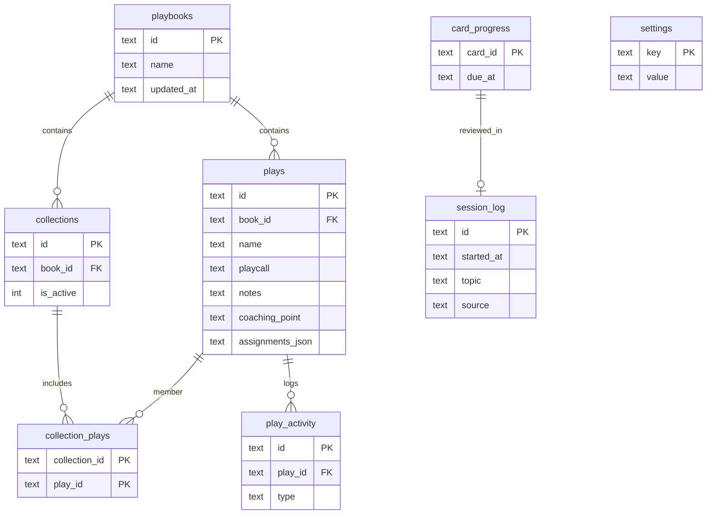
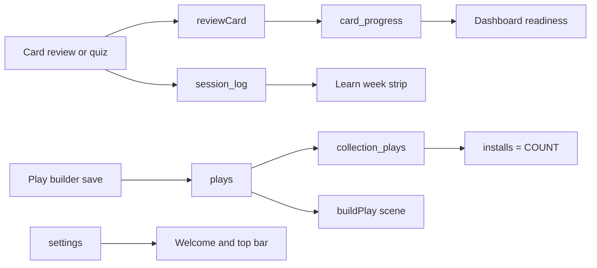

# Schema: local data model for plays, training, and settings

Define and implement the on-device data model so Learn, Playbook, and Dashboard can share one source of truth. Persistence stays local (SQLite on native, AsyncStorage on web). This plan is the schema and storage layer only — not the page UI.

App: `football-flashcards` (Expo 57 / RN 0.86, Expo Router). Product UI: **Audible**. Native DB: `audible.db`.

Related page plans (consume this schema; do not invent parallel models):

- [dashboard-real-features.md](./dashboard-real-features.md)
- [learn-dashboard-real-features.md](./learn-dashboard-real-features.md)
- [playbook-real-features.md](./playbook-real-features.md)

Main files:

- [src/training/types.ts](../src/training/types.ts)
- [src/training/storage.native.ts](../src/training/storage.native.ts)
- [src/training/storageAsync.ts](../src/training/storageAsync.ts)
- [src/training/storage.ts](../src/training/storage.ts)
- [src/training/storageSeed.ts](../src/training/storageSeed.ts)
- [src/training/cards.ts](../src/training/cards.ts)
- [src/core/parser/resolve.ts](../src/core/parser/resolve.ts)
- [src/__tests__/storage.test.ts](../src/__tests__/storage.test.ts)

Decisions already made: no backend. An install is a collection flagged active. Flashcards and field scenes are generated, not stored. Team / roster / multi-user stay out of the schema.

## Todos

- [x] **Phase 1:** Types — `Collection`, `StudySession`, `UserSettings`, `PlayActivity`; extend `Playbook` and `PlaybookPlay`
- [x] **Phase 2:** SQLite v2 migration — new tables/columns, FKs, indexes; stop wipe-and-reinsert from dropping related rows
- [x] **Phase 3:** AsyncStorage parity — same shapes and functions, backfill old playbook blobs
- [x] **Phase 4:** Seed starter collections; derive `installs`; persist assignment JSON; UUID play ids
- [x] **Phase 5:** Storage tests, typecheck; keep this file as the living schema

## What exists today

SQLite tables in `storage.native.ts` (created with `CREATE TABLE IF NOT EXISTS`, flagged `migrated_v1`):

| Table | Role | Gaps |
| --- | --- | --- |
| `playbooks` | Book metadata | Fine. UI still uses `books[0]`. |
| `plays` | Play rows | Missing `coaching_point`, `assignments_json`. Stores mock `preview_*` and a seeded `installs` number. |
| `card_progress` | SM-2 state keyed by generated card id | Fine. Keep as-is. |
| `user_stats` | KV for streak / week counters | Cannot power a real week strip or season report. `weekGoal` belongs in settings. |
| `meta` | KV for migration flags | Keep for schema version only. |

Missing entirely: collections, collection membership, session history, play activity, profile settings.

Other problems:

- `savePlaybooks` does `DELETE FROM plays; DELETE FROM playbooks;` then reinserts. Any new related tables will be orphaned or wiped unless this is fixed.
- `updatePlay` / `markPlayViewed` load-all / mutate / `savePlaybooks` instead of updating one row.
- New play ids are `play-${Date.now()}`.
- `enrichPlay` guesses formation / concept / personnel from substrings and invents `installs` / preview art.
- Flashcard ids in `cards.ts` are already stable (`formation-${id}`, `route-${id}`, `personnel-${code}`, …). Progress can keep keying off those. Do not store card content.

## Persist vs derive vs omit

**Persist (source of truth)**

- User-authored plays: name, playcall, notes, coaching point, assignment overrides, coverage / front overlay, favorite, review count, timestamps
- Collections and play membership (one collection per book may be `is_active` — that is the current install)
- SRS row per generated `card_id`
- Study session history
- Profile: display name, role, weekly goal, optional season start

**Derive at read time (do not treat as source of truth)**

- `installs` = number of collections that contain the play
- Tags = concept + formation + names of collections the play belongs to
- Assignments list on the play detail screen = offensive players from `buildPlay(...)`
- Week strip / week session count = rows in `session_log` for the current week
- Mastery / readiness / due counts = `card_progress` + generated cards
- `PlayScene` = `buildPlay(playcall, { assignments, coverageId, frontId })`

**Do not persist**

- `FlashCard` prompt / answer / distractors / scene
- `PlayScene` geometry (players, arrows, zones)
- `previewColor` / `previewRoutes` (leave existing SQLite columns unused; stop writing them)
- Authored lesson documents (a lesson is a chunk of ~10 generated cards)
- Team, roster, players, or any multi-user / sync tables

`concept`, `formation`, and `personnel` stay on the play as an **editable cache**. Writes should prefer values from the parsed playcall (`playMeta`); the user can override. They are not a second catalog of formations.

`roster_size` on a collection is a hand-entered number until a Team feature exists.

## Target types

Add to [src/training/types.ts](../src/training/types.ts):

```ts
export interface Collection {
  id: string;
  bookId: string;
  name: string;
  color: string;
  isActive: boolean;
  rosterSize?: number;
  targetDate?: string; // ISO date
  description?: string;
  createdAt: string;
}

export type PlayActivityType =
  | 'created'
  | 'edited'
  | 'favorited'
  | 'unfavorited'
  | 'added_to_collection'
  | 'removed_from_collection'
  | 'reviewed';

export interface PlayActivity {
  id: string;
  playId: string;
  type: PlayActivityType;
  payload?: Record<string, string>;
  createdAt: string;
}

export interface StudySession {
  id: string;
  startedAt: string; // ISO
  topic: TrainingTopic;
  cardsReviewed: number;
  correct: number;
  durationSec: number;
  xp: number;
  source: 'flashcards' | 'quiz';
}

export interface UserSettings {
  displayName: string;
  role: string;
  weeklyGoal: number;
  /** Null means calendar year. */
  seasonStart: string | null;
}
```

Extend existing types:

```ts
export interface PlaybookPlay {
  // existing fields...
  assignments?: Record<string, AssignmentOverride>;
  coachingPoint?: string;
  // installs is derived at read time; keep optional for back-compat reads
}

export interface Playbook {
  id: string;
  name: string;
  plays: PlaybookPlay[];
  collections: Collection[];
  updatedAt: string;
}
```

New play and collection ids: UUID. Stop `play-${Date.now()}`.

`UserStats` stays as a streak cache (`streakDays`, `bestStreak`, `lastSessionDate`, `weekStart`). `weekSessions` is derived from `session_log`. Move `weekGoal` reads to `UserSettings`.

## Target SQLite schema (v2)

Enable `PRAGMA foreign_keys = ON` and keep `PRAGMA journal_mode = WAL`.

```sql
-- existing, unchanged
CREATE TABLE IF NOT EXISTS playbooks (
  id TEXT PRIMARY KEY NOT NULL,
  name TEXT NOT NULL,
  updated_at TEXT NOT NULL
);

CREATE TABLE IF NOT EXISTS card_progress (
  card_id TEXT PRIMARY KEY NOT NULL,
  easiness REAL NOT NULL,
  interval_days REAL NOT NULL,
  repetitions INTEGER NOT NULL,
  due_at TEXT NOT NULL,
  last_result TEXT
);

CREATE TABLE IF NOT EXISTS user_stats (
  key TEXT PRIMARY KEY NOT NULL,
  value TEXT NOT NULL
);

CREATE TABLE IF NOT EXISTS meta (
  key TEXT PRIMARY KEY NOT NULL,
  value TEXT NOT NULL
);

-- existing + new columns via ALTER in migrated_v2
CREATE TABLE IF NOT EXISTS plays (
  id TEXT PRIMARY KEY NOT NULL,
  book_id TEXT NOT NULL REFERENCES playbooks(id) ON DELETE CASCADE,
  name TEXT NOT NULL,
  playcall TEXT NOT NULL,
  notes TEXT,
  coaching_point TEXT,
  coverage_id TEXT,
  front_id TEXT,
  concept TEXT,
  formation TEXT,
  personnel TEXT,
  assignments_json TEXT,          -- Record<string, AssignmentOverride>
  preview_color TEXT,             -- unused; leave in place
  preview_routes TEXT,            -- unused; leave in place
  favorite INTEGER NOT NULL DEFAULT 0,
  installs INTEGER NOT NULL DEFAULT 0, -- unused; derive on read
  review_count INTEGER NOT NULL DEFAULT 0,
  created_at TEXT NOT NULL,
  updated_at TEXT NOT NULL,
  last_viewed_at TEXT
);

CREATE TABLE IF NOT EXISTS collections (
  id TEXT PRIMARY KEY NOT NULL,
  book_id TEXT NOT NULL REFERENCES playbooks(id) ON DELETE CASCADE,
  name TEXT NOT NULL,
  color TEXT NOT NULL,
  is_active INTEGER NOT NULL DEFAULT 0,
  roster_size INTEGER,
  target_date TEXT,
  description TEXT,
  created_at TEXT NOT NULL
);

CREATE TABLE IF NOT EXISTS collection_plays (
  collection_id TEXT NOT NULL REFERENCES collections(id) ON DELETE CASCADE,
  play_id TEXT NOT NULL REFERENCES plays(id) ON DELETE CASCADE,
  sort_order INTEGER NOT NULL DEFAULT 0,
  PRIMARY KEY (collection_id, play_id)
);

CREATE TABLE IF NOT EXISTS play_activity (
  id TEXT PRIMARY KEY NOT NULL,
  play_id TEXT NOT NULL REFERENCES plays(id) ON DELETE CASCADE,
  type TEXT NOT NULL,
  payload_json TEXT,
  created_at TEXT NOT NULL
);

CREATE TABLE IF NOT EXISTS session_log (
  id TEXT PRIMARY KEY NOT NULL,
  started_at TEXT NOT NULL,
  topic TEXT NOT NULL,
  cards_reviewed INTEGER NOT NULL,
  correct INTEGER NOT NULL,
  duration_sec INTEGER NOT NULL,
  xp INTEGER NOT NULL,
  source TEXT NOT NULL
);

CREATE TABLE IF NOT EXISTS settings (
  key TEXT PRIMARY KEY NOT NULL,
  value TEXT NOT NULL
);
```

Indexes:

```sql
CREATE INDEX IF NOT EXISTS idx_plays_book ON plays(book_id);
CREATE INDEX IF NOT EXISTS idx_plays_viewed ON plays(last_viewed_at);
CREATE INDEX IF NOT EXISTS idx_plays_updated ON plays(updated_at);
CREATE INDEX IF NOT EXISTS idx_collections_book ON collections(book_id);
CREATE INDEX IF NOT EXISTS idx_collection_plays_play ON collection_plays(play_id);
CREATE INDEX IF NOT EXISTS idx_play_activity_play ON play_activity(play_id, created_at);
CREATE INDEX IF NOT EXISTS idx_session_log_started ON session_log(started_at);
CREATE INDEX IF NOT EXISTS idx_session_log_topic ON session_log(topic);
CREATE INDEX IF NOT EXISTS idx_card_progress_due ON card_progress(due_at);
```

Only one active collection per book. Enforce in `setActiveCollection` (clear others, then set). SQLite has no portable partial unique index we should rely on here.

Cap `play_activity` at ~50 rows per play on write (delete oldest).

### Settings vs stats vs meta

| Store | Keys | Notes |
| --- | --- | --- |
| `meta` | `migrated_v1`, `migrated_v2` / `schema_version` | Migration flags only |
| `settings` | `displayName`, `role`, `weeklyGoal`, `seasonStart` | Profile + Learn goal. Replaces the dashboard plan's `audible/profile` key. |
| `user_stats` | `streakDays`, `bestStreak`, `lastSessionDate`, `weekStart` | Cache updated when `recordSession` runs. Do not use it for the week strip. |

Default settings: `displayName = ''` (UI falls back to "Coach"), `role = 'Offense'`, `weeklyGoal = 4`, `seasonStart = null`.





## Storage API

Same signatures on both backends (`storage.native.ts` and `storageAsync.ts`).

Collections:

- `createCollection(bookId, input)`
- `updateCollection(id, patch)`
- `deleteCollection(id)` — membership rows cascade
- `setActiveCollection(bookId, id)` — only one active per book
- `addPlayToCollection(collectionId, playId)`
- `removePlayFromCollection(collectionId, playId)`
- `duplicatePlay(bookId, playId)` — new UUID, copy assignments / notes, not activity or review count; membership is not copied unless the caller adds it

Sessions and settings:

- `recordSession(session)` — insert log row, then update streak cache via existing `applyStudySession`
- `loadSessionLog(opts?)` — optional `{ since, topic }`
- `loadSettings` / `saveSettings`

Activity:

- `appendPlayActivity(entry)` — insert and trim to 50
- `loadPlayActivity(playId)`

Keep existing play / progress functions, but:

- `addPlayToBook` / `updatePlay` write the play row (and `assignments_json`) directly. Do not wipe the book.
- `savePlaybooks` must also rewrite `collections` and `collection_plays`, or stop being a full replace.
- `loadPlaybooks` attaches `collections` and sets `installs` from membership counts.
- `markPlayViewed` increments `review_count` at most once per app session (or only when opened from the playbook), and writes a `reviewed` activity row.

Soft cap: `PLAYBOOK_PLAY_LIMIT = 100` enforced in `addPlayToBook`. The storage meter uses `total / limit` as a 0..1 ratio.

## Migration (`migrated_v2`)

1. `ALTER TABLE plays ADD COLUMN coaching_point TEXT;`
2. `ALTER TABLE plays ADD COLUMN assignments_json TEXT;`
3. `CREATE TABLE` for `collections`, `collection_plays`, `play_activity`, `session_log`, `settings` plus indexes.
4. Seed starter collections on the default book if none exist, for example "Red zone" and "Third down", with real `play_id`s from seeded plays. No fabricated counts.
5. Do not backfill `installs` or delete `preview_*` columns.
6. Existing `card_progress` and `user_stats` rows stay.

AsyncStorage keys (same shapes as the SQLite rows):

| Key | Contents |
| --- | --- |
| `audible/playbooks` | Existing blob; each book gains `collections: Collection[]` (backfill `[]`) |
| `audible/card-progress` | Unchanged |
| `audible/user-stats` | Unchanged streak cache |
| `audible/session-log` | `StudySession[]` |
| `audible/settings` | `UserSettings` |
| `audible/play-activity` | `PlayActivity[]` (sibling key so play rows stay small) |

Keep the existing `ff/*` → `audible/*` legacy migration.

`storage.ts` remains the web re-export of `storageAsync`. Metro already resolves `storage.native.ts` on iOS / Android. Do not add a third backend. Confirm which file is live before editing; do not treat [src/storage/db.ts](../src/storage/db.ts) as current (it is stale / unused).

## Seed and derived metadata

- `defaultPlaybook()` / `defaultPlaybooks()` seed the on-device library.
- Stop seeding fake `installs` numbers.
- A later Playbook-plan helper `playMeta.ts` will fill concept / formation / personnel from the playcall. Schema work only needs a place to store those fields and assignments.
- `AssignmentOverride` is `{ routeId: string; depth?: number }` from [src/core/parser/resolve.ts](../src/core/parser/resolve.ts). Persist as JSON on the play.

### Seeded books (`PACKERS_SEED_VERSION` = 5)

Content is a **training reconstruction from public film / scheme reporting**, not official team documents. Display names are free teaching labels; playcalls use the west-coast (and air-coryell) lexicon.

| Book id | Source file | Notes |
| --- | --- | --- |
| `packers-2026` | [src/data/packersPlaybook.ts](../src/data/packersPlaybook.ts) + [src/data/packersDefense.ts](../src/data/packersDefense.ts) | Offense + `side: 'def'` Gannon looks (`gb-d-*`). Active collection stays "Bears Week 5". |
| `bears-2026` | [src/data/bearsPlaybook.ts](../src/data/bearsPlaybook.ts) | Ben Johnson offense (`chi-*`). Inserted beside Packers; user edits on existing seed plays are preserved on upgrade. |

Upgrades use `ensureSeededPlaybooks` / `mergeMissingPackersSeed` (async) and SQLite `migrateV7` (`INSERT OR IGNORE` for new plays). Existing Packers play rows are never rewritten.

## Tests

Extend [src/__tests__/storage.test.ts](../src/__tests__/storage.test.ts) (Jest uses the AsyncStorage / in-memory backend):

- Collections: create, activate (only one active), add / remove plays, delete, duplicate
- `installs` equals membership count
- Settings round-trip (name, role, weekly goal)
- `recordSession` appends a log row and updates streak cache
- Play `assignments` survive `addPlayToBook` / `loadPlaybooks`
- Activity cap at 50
- Old playbook blobs without `collections` still load

Then `npm test` and `npm run typecheck`. Per `AGENTS.md`, check Expo 57 SQLite docs before touching any Expo API (`docs.expo.dev/versions/v57.0.0/`).

## How the page plans use this

| Page plan need | Schema answer |
| --- | --- |
| Learn week strip, season best, report trends | `session_log` |
| Learn / dashboard weekly goal and greeting | `settings` |
| ContinueTraining / resume / due badges / readiness | `card_progress` + generated cards |
| Quiz XP | `session_log.xp` + streak cache |
| Playbook collections sidebar and current install | `collections` + `collection_plays` |
| Play assignments, notes, coaching point | `plays.assignments_json`, `notes`, `coaching_point` |
| Play activity tab | `play_activity` |
| Play tags | derived |
| Builder save keeping route overrides | `assignments_json` |
| Team readiness / roster | out of scope; `roster_size` is manual |

## Explicit non-goals

- Learn quiz engine, report screen, Playbook sidebar UI, presentation mode, search / help sheets
- Team, roster, or sync tables
- Storing generated flashcards or scenes
- Multiple playbook UX (schema already has `book_id`; UI stays on `books[0]`)
- Dropping unused `preview_*` / `installs` columns (avoid a destructive migration)

## Suggested delivery order

Phase 1 (types) then 2 (SQLite) then 3 (AsyncStorage) — they must stay in lockstep. Phase 4 seed / derive next, then tests. After this ships, Playbook Phase 1 and Learn Phase 0 in the page plans become "wire to the API" instead of "invent tables".
